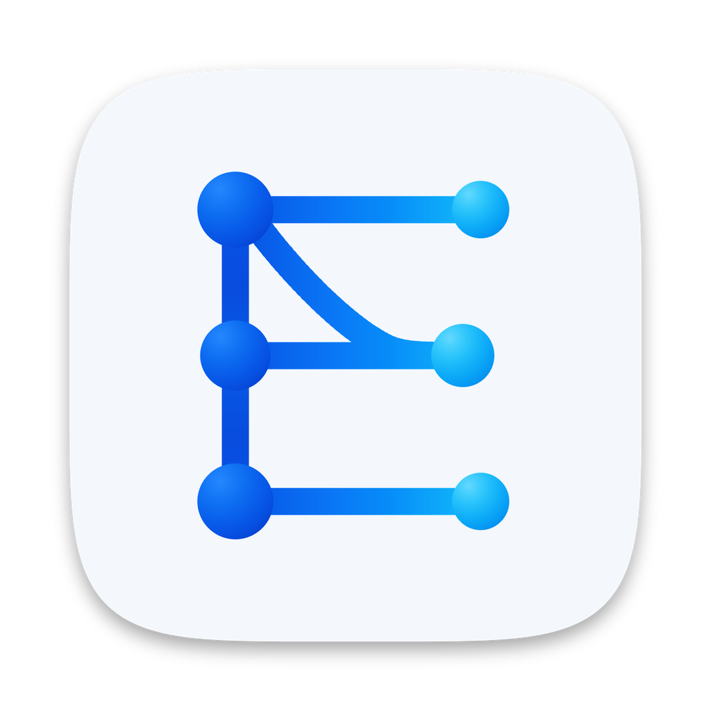

# Anonymizer

Локальная программа с собственным окном для безопасной работы с конфиденциальными файлами во внешних языковых моделях (Claude, ChatGPT и других). Имена, компании, города, почта и другие данные заменяются устойчивыми метками, после работы модели исходные значения возвращаются в файл. Браузер не используется: окно показывает встроенный компонент системы (на Windows это WebView2).

Версия программы одна и берётся из `anonymizer/__init__.py`. История изменений: [CHANGELOG.md](CHANGELOG.md). Все документы: [docs/README.md](docs/README.md).

## Возможности

- Обезличивание и восстановление файлов `.xlsx`, `.docx`, `.pptx`, `.pdf` и текстовых форматов с устойчивыми метками.
- Целая папка одним заданием; кнопка в Word, Excel и PowerPoint (Office add-in) для работы с открытым документом.
- Чаты с файлами и необязательная работа с ИИ: провайдеры (Anthropic, OpenAI, Gemini, OpenRouter, свой адрес), правка текстовых файлов и документов Office по просьбе, необязательный `policy.json` для администратора.
- Панель просмотра файла (обезличенный, исходный, возвращённый, версии).
- Картинки и сканы: замена меткой или закраска текста с проверкой распознаванием.
- Отказы вместо молчаливых ошибок: нечитаемые, защищённые и неподдерживаемые файлы отклоняются с причиной.
- Обезличивание и восстановление работают без сети. Сеть используется для включённого ИИ-чата и проверки обновлений на GitHub.

## Установка

Скачать готовые сборки: [GitHub Releases — lev1e/Enigma](https://github.com/lev1e/Enigma/releases/latest). Исходный код и работа над надстройкой: [lev1e/Enigma](https://github.com/lev1e/Enigma).

- **macOS (Apple Silicon):** образ DMG из раздела Releases репозитория. Подписи Developer ID нет: при первом запуске система спросит подтверждение (инструкция лежит в образе). Обновления приходят через программу. Порядок выпуска: [docs/MAC_RELEASE.md](docs/MAC_RELEASE.md).
- **Windows 10 и 11 (x64):** установщик, требуется Microsoft Edge WebView2 Runtime (установщик докладывает его при отсутствии). Установщик не подписан, SmartScreen покажет предупреждение. Подробная инструкция: [docs/WINDOWS_INSTALL.md](docs/WINDOWS_INSTALL.md).
- **Из исходников:** Python 3.12, зависимости из `requirements.txt`, запуск `python main.py`. Подробнее: [DEVELOPMENT.md](DEVELOPMENT.md).

Быстрый старт: [QUICKSTART.md](QUICKSTART.md).

## Основной сценарий

**Обезличить.** Выбрать файл (диалог или перетаскивание в окно) → «Обезличить» → «Сохранить как…». Результат — тот же файл с той же структурой, где чувствительные данные заменены метками:

| Что найдено | Метка |
|---|---|
| ФИО, имена, фамилии | `Name1`, `Name2` |
| Компании и клиенты | `Company1` |
| Проекты и объекты | `Project1` |
| Города, регионы, адреса | `City1`, `Region1`, `Address1` |
| Email, телефоны, сайты | `email1@example.com`, `Phone1`, `Domain1` |
| Имена файлов | `File1` |
| Паспорта, ИНН, СНИЛС, карты, договоры | `Passport1`, `Inn1`, `Snils1`, `Card1`, `Contract1` |
| Пароли и ключи | `Secret1` (удаляются безвозвратно) |

Один и тот же объект всегда получает одну и ту же метку — в любом файле и при любом запуске. Другие написания того же объекта получают `Name1_2`, `Name1_3`: модель видит, что это один человек, а возврат восстанавливает написание точно (`Иванову И.И.` остаётся `Иванову И.И.`).

**Восстановить.** Выбрать файл, который вернула модель → «Восстановить» → «Сохранить как…». Ключ или проект выбирать не нужно: соответствия хранятся в зашифрованном хранилище на этом компьютере.

Восстановление не зависит от того, что модель сделала с файлом: перенесла данные на другой лист, переставила строки, дописала текст, изменила регистр меток, обернула их в markdown. Метка ищется в любом тексте файла — в ячейках, формулах, названиях листов, колонтитулах, диаграммах.

## Что сохраняется в файле

Excel, Word и PowerPoint не пересобираются через Office: ZIP-контейнер переписывается запись за записью, изменяются только текстовые узлы. Листы, формулы, форматирование, таблицы, диаграммы, комментарии и изображения остаются как были. Данные во вложенных книгах диаграмм тоже обезличиваются. PDF обрабатывается настоящей редакцией (исходный текст удаляется, а не закрашивается).

Поддерживаются: `.xlsx`, `.docx`, `.pptx`, `.pdf`, `.txt`, `.csv`, `.md`, `.json`, `.xml`, `.html`, `.log`, `.yaml`.

## Что программа не делает молча

Каждый результат сопровождается проверкой:

- файл открывается стандартными средствами, формулы не ссылаются на несуществующие листы;
- в результате повторно ищутся замененные значения;
- слова, в которых программа не уверена (возможные фамилии, названия, аббревиатуры), не заменяются, а показываются списком: отметьте нужное, и файл обезличивается заново;
- если данных для замены не найдено, это предупреждение, а не успех;
- при возврате перечисляются метки, которых нет в хранилище (модель могла придумать свои), и файлы, к которым относятся восстановленные метки;
- файл Office или PDF, обезличенный другим хранилищем (другой компьютер, очищенное хранилище), не восстанавливается: одинаковые метки там означают другие значения. Для этого в свойства файла записывается идентификатор хранилища; он снимается при возврате. Если модель пересохранила файл и пометка пропала, проверка не срабатывает;
- метки, которые модель испортила (`Name 1`, `Name1Name2`), называются в отчёте;
- изображения внутри файла не читаются, об этом сказано прямо.

## Дополнительно

- **Свои слова.** «Всегда скрывать» (внутренние названия проектов и клиентов) и «Никогда не скрывать» (слова, которые программа приняла за имена) — в настройках; для одного файла слова можно добавить в блоке «Дополнительно».
- **Числа в Excel.** Суммы и объёмы заменяются правдоподобными числами, при возврате возвращаются. Даты и годы не меняются, результаты формул очищаются (Excel пересчитает при открытии). По умолчанию выключено. Число, которое модель посчитала заново и которое случайно совпало с заменённым, при возврате тоже заменится на исходное.
- **Телефон, карта, СНИЛС числом в ячейке.** Такие значения заменяются всегда, ячейка становится текстовой и после возврата остаётся текстовой.
- **Хранилище.** Срок хранения соответствий, очистка, резервная копия с паролем и загрузка копии — в настройках.

## Add-in для Word, Excel и PowerPoint

Кнопка Anonymizer на ленте Office обезличивает **открытый документ на месте** и возвращает исходные данные тем же способом, что и программа: метки и хранилище общие.

1. Подключение: установщик (задача «Подключить к Word, Excel и PowerPoint»), либо Настройки → «Подключить», либо `Anonymizer.exe --install-addin`. Система спросит подтверждение сертификата локальной страницы (он действует только для `localhost`).
2. На ленте (вкладка «Главная») одна кнопка Anonymizer с логотипом: она открывает панель, где «Обезличить документ» и «Вернуть данные». Работайте с файлом в ИИ, потом нажмите «Вернуть данные». Если кнопки нет (Mac и sideload в Windows показывают её после первого открытия в сеансе Office): Вставка, Надстройки, Anonymizer.
3. Перед заменой программа сохраняет зашифрованную копию документа (7 дней): кнопка «Откатить к исходному» и список копий в «Дополнительно».
4. После замены панель заново читает документ и сверяет его с результатом. Расхождения (потерянный текст, оставшиеся значения, листы, слайды, колонтитулы) показываются списком, а не молча.
5. Сомнительные слова и исправления Word останавливают автозамену: сначала показывается список для проверки.

Программа должна работать: окно по крестику прячется, пока add-in подключён (полностью выйти: Настройки → «Выйти из программы»). В фоне она не потребляет процессор.

Ограничения Office, которые панель не может обойти: в Office.js нет вызова «заменить файл целиком», поэтому документ собирается вставкой из файла; свойства файла в PowerPoint для Mac изменить нельзя (панель об этом пишет), а имя автора Office дописывает сам при каждом сохранении (панель предупреждает).

## Целая папка

В окне программы кнопка «Выбрать папку» (вкладки «Обезличить» и «Восстановить»). Папка обходится вместе с подпапками, все файлы идут одним заданием: одна сущность получает одну метку во всех файлах. Результат записывается в соседнюю папку `Папка{N} (обезличено)` / `... (восстановлено)` с той же структурой; имена подпапок и файлов нейтральные и возвращаются при восстановлении. Исходная папка не меняется, неподдерживаемые файлы перечисляются в отчёте.

## ИИ-чат (по желанию)

Выключен по умолчанию. Включается в двух местах: в настройках провайдера (страница «ИИ-чат») и отдельно для каждого чата. В чате с файлами внизу всегда есть строка сообщения (Enter отправляет, Shift+Enter переносит строку). Провайдеры: Anthropic, OpenAI, Google Gemini, OpenRouter, свой адрес (в том числе локальная модель). Ключ хранится в связке ключей системы и в страницу не возвращается.

Сеть: страница говорит только с локальным сервером; к провайдеру обращается программа, одним запросом на сообщение. Уходит обезличенный текст с метками и последние сообщения беседы в том же виде. Перед отправкой исходящая проверка сверяет текст с хранилищем и запускает распознавание: любая находка блокирует отправку, возможные имена и термины можно обезличить или разрешить один раз. «Показать запрос» выводит точное тело запроса. Ответ возвращается на экран с исходными значениями; в беседе и в следующих запросах остаются только метки. Кнопка «Остановить» обрывает ответ. Подробности и пределы: SECURITY.md.

Провайдеры и модели: кроме перечисленных можно добавить свои OpenAI-совместимые адреса (например, внутреннюю «Тедорру»): страница «ИИ-чат», блок «Провайдер». У провайдера есть метка «внутренняя» или «внешняя» (это подпись, не защита). Модель выбирается компактным списком в строке сообщения и запоминается для чата.

Исходные данные: в меню «+» у каждого файла можно выбрать версию, которая уходит модели: «Обезличенный» (по умолчанию) или «Исходный». Для исходного файла проверка персональных данных не блокирует отправку, меток нет, ответ показывается как есть. Перед отправкой появляется строка «Отправляются исходные данные: провайдер (внутренняя/внешняя)», Enter подтверждает. Пароли, ключи и токены, которые программа распознаёт, не уходят и в этом режиме. Администратор может позже ограничить это необязательным файлом `policy.json` (подробности в SECURITY.md); без файла ограничений нет. Проверено только на локальном поддельном провайдере.

Правка файла по просьбе: в строке сообщения можно попросить ИИ изменить обезличенный текстовый файл (txt, md, csv, tsv, json, html, xml, log, yaml). Результат сохраняется как новая версия, исходный файл и прежние версии остаются, в панели просмотра версия помечена как новая. Для docx, xlsx, pptx и pdf правка в файл не переносится: программа показывает только текстовый ответ. Не сделано: отправка вложений. Проверено на локальном поддельном провайдере; реальные провайдеры и Windows не проверялись.

### Правка файлов Office через ИИ

В чате ИИ может предложить правки для docx, xlsx и pptx (текст и оформление): они показываются карточками «было, стало», применяются целиком или выбранными, и каждое применение создаёт новую версию файла (исходный файл и прежние версии остаются). Править можно обезличенную или исходную версию; пароли и ключи в любом случае скрыты. Подробности и пределы: SECURITY.md, раздел «Правка docx, xlsx и pptx через ИИ».

## Панель просмотра файла

В чате с файлами справа открывается панель просмотра (вкладки «Обезличенный», «Исходный», «Возвращённый», версии). Показываются текст, markdown (с подсветкой меток), таблицы (все листы xlsx вкладками), документы Word, слайды, страницы PDF и картинки. Ширину панели можно менять мышью или стрелками с клавиатуры (Home/End, двойной щелчок или Enter сбрасывают). «Исходный» и «Возвращённый» остаются на этом компьютере и подписаны как содержащие настоящие данные. Панель ничего не загружает из сети; подробности в SECURITY.md. Сторонние библиотеки (marked, DOMPurify, highlight.js) лежат в `anonymizer/web/vendor/`, перечень и лицензии: `THIRD_PARTY_NOTICES.md`. Ячейки xlsx с объединением показываются обычной сеткой.

## Ограничения

### Изображения и сканы

- По умолчанию картинка заменяется целиком меткой, а оригинал хранится зашифрованным в хранилище и возвращается при восстановлении. Лица, подписи, печати и рукописный текст программа не ищет, поэтому ни одна часть картинки не остаётся в файле.
- Режим «закрасить текст, оставить картинку» помечен как менее безопасный: логотипы и лица остаются видимыми, программа предупреждает об этом в настройках и в результате. Он нужен, когда ИИ должен читать скан. Он работает по принципу «лучшее, что возможно»: текст распознаётся несколько раз (разный масштаб и поворот), закрашивается, затем результат проверяется независимым распознаванием. Если что-то читается или страница содержит рукопись, печати, фото или QR-коды, которые закрыть нельзя, файл отклоняется. Гарантией это не является.
- Отклоняются, а не пропускаются: изображения низкого разрешения или нечитаемые для распознавания, сканы, в которых часть номера остаётся видимой после закраски, форматы `.tiff` и `.webp` (в этой версии не поддерживаются).
- Распознавание: Apple Vision на Mac; в Windows встроенное распознавание Windows, для него в системе должны быть установлены языки распознавания русского и английского. Других языков нет.

### Форматы и скорость

- Поддерживаются перечисленные выше форматы. `.xls`, `.doc`, `.ppt`, `.rtf`, `.odt` и файлы с макросами, паролем или подписью отклоняются с объяснением.
- Замеры (Mac, тестовые наборы проекта, 12-14.10; полный список: `docs/superpowers/status-2026-10-14.md`): английский набор реальных документов, 131 файл, 4030 вставленных значений: 4 остались в тексте. Русский текстовый набор v1: полнота .996, точность .997. Файл `.txt` 12 МБ обрабатывается около 180 секунд процессорного времени (цель 60 секунд не достигнута, 14.10). Сканы и PDF на Mac: распознавание страницы около 0,1–0,5 секунды; на Windows замеров нет.
- Восстановление PDF: на английском наборе 39 из 52 файлов (13.10) вернулись с тем же содержимым, остальные возвращаются с потерями и отчёт это показывает.

### Что не проверено

- Сборка для Windows, установщик, распознавание Windows, хранение ключа через DPAPI и кнопка в Word, Excel и PowerPoint проверены только чтением кода и на Mac. Пошаговая проверка на настоящем Windows лежит в `docs/superpowers/windows-verification.md` и пока не выполнена.
- Нейросеть natasha: лицензия обучающих данных не проверена; работа в собранной под Windows программе (gate G12 в `release-checklist.md`) не проверена; объём предложений на реальных документах не измерен.
- Живой ИИ-провайдер, хранение ключа через Keychain/DPAPI, файлы `html_ru_putin` и `html_en_musk` (исходники отсутствуют) не проверены.
- Установщик не подписан: Windows покажет предупреждение SmartScreen.
- Работа на реальных документах, не похожих на тестовые наборы, не измерена: ждите пропусков и проверяйте список «Возможно, нужно скрыть ещё».

- Метки живут в хранилище на этом компьютере: файл, обезличенный на другом компьютере, здесь не восстановится (для переноса есть резервная копия). Файлы Office и PDF из чужого хранилища программа распознаёт и отклоняет; в текстовых файлах пометки нет, и чужие метки будут заменены значениями этого хранилища.
- Значения, которые программа не распознала, остаются в файле. Проверяйте список «Возможно, нужно скрыть ещё».
- Компании и проекты без юридической формы, кавычек и слова-подсказки не находятся автоматически. После слов «клиент», «компания», «проект» они попадают в список предложений, но не заменяются сами.
- Одиночная фамилия заменяется сразу только после должности («Директор Сидоров», «Ответственный: Абдуллаев») и в столбце «ФИО». После глагола и в прозе она предлагается на проверку.
- Вложенные файлы PDF, имена закладок Word, названия пользовательских свойств документа и значения атрибутов надстроек не обезличиваются. Программа сообщает о вложенных файлах PDF.
- Дата рождения, стоящая в одной ячейке, а подпись «Дата рождения» в соседней, не находится.

## Разработка и выпуск

Окружение, запуск, тесты, проверки качества и сборка: [DEVELOPMENT.md](DEVELOPMENT.md). Устройство: [ARCHITECTURE.md](ARCHITECTURE.md). Модель угроз и пределы гарантий: [SECURITY.md](SECURITY.md). Выпуск: [docs/superpowers/release-checklist.md](docs/superpowers/release-checklist.md) и [docs/MAC_RELEASE.md](docs/MAC_RELEASE.md). Итоговый файл Windows запускается с `--selfcheck файл.json` и без окна проверяет ресурсы страницы, словарь, компонент окна, сервер и полный круг.

## Лицензия

Лицензия пока не выбрана; все права принадлежат автору. Сторонние компоненты и их лицензии: [THIRD_PARTY_NOTICES.md](THIRD_PARTY_NOTICES.md).
